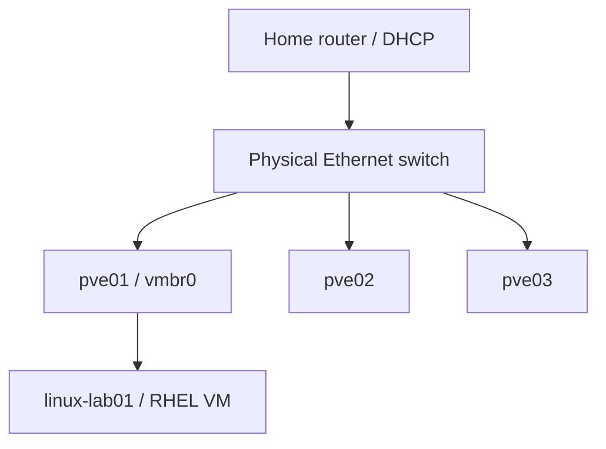

# Management Network Validation and DHCP Configuration

## Objective and outcome

Build a reliable management network before joining the three Proxmox hosts. All nodes passed the router, public-IP connectivity, hostname lookup, storage, and time synchronization checks. Inter-node ping tests returned 0% packet loss during validation.

## Address plan

| Device | Address | Assignment |
|---|---|---|
| Router / default gateway | `192.168.1.1` | Existing home gateway |
| pve01 | `192.168.1.10` | Manually configured |
| pve02 | `192.168.1.11` | Manually configured |
| pve03 | `192.168.1.12` | Manually configured |
| linux-lab01 | `192.168.1.108` | DHCP address observed during setup; may change |
| Automatic DHCP pool | `192.168.1.100`–`192.168.1.254` | Router-managed clients |

These are private lab addresses. No public exposure or port forwarding was configured in this setup.

The router connects to the switch through a LAN port. Each host connects to the switch. The VM uses a virtual network adapter attached to `vmbr0`. A patch panel organizes physical cable connections; it is not a replacement for the switch.

## DHCP overlap resolved

The Optimum Fiber 6 Gateway originally offered addresses from `.11` to `.254`, overlapping the manually configured pve02 and pve03 addresses. I changed the starting address to `.100`, leaving the ending address at `.254`.

This separates the three host addresses from future automatic assignments. I checked the connected-device/lease information and found no other devices using the same addresses. Changing a DHCP pool does not create reservations, change the subnet, or necessarily invalidate existing leases immediately. No DHCP reservations were recorded as configured.

## Commands and interpretation

Run host checks in the relevant Proxmox Shell; run VM checks in the RHEL terminal.

| Command | Explanation |
|---|---|
| `ip -br addr` | `ip` inspects networking; `-br` gives brief output; `addr` lists interface addresses. Management IPs appeared on `vmbr0`. |
| `ip route` | Lists routes. `default via 192.168.1.1` identifies the gateway for destinations without a more specific route. |
| `ping -c 4 192.168.1.1` | Sends four ICMP echo requests to the router. |
| `ping -c 4 1.1.1.1` | Tests reachability of a public IP without depending on hostname resolution. |
| `getent ahostsv4 debian.org` | Queries configured name services for IPv4 addresses. Returned addresses demonstrate successful lookup, not an ICMP packet-loss measurement. |
| `hostnamectl` | Displays hostname and OS information. |
| `timedatectl` | Displays time settings and synchronization state. |

For peer checks, I tested the other nodes' management IPs from the hosts. Successful ping is one connectivity check; it does not prove every cluster service/port is reachable.

The three hosts showed correct local time, active NTP, and a synchronized system clock. Consistent clocks help correlate incident logs and support cluster operation.

## Learning notes

- `proto kernel` means Linux generated the route, commonly from interface addressing.
- `scope link` means the destination is directly reachable on that link.
- `src` identifies the preferred source address for traffic using the route.
- `vmbr0` is a Linux bridge, effectively a virtual switch.
- Network segmentation, VLAN tagging, switch management-IP configuration, and advanced switch settings are not yet implemented.
